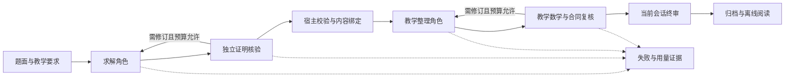

# AI for Education · 可审计数学教学 AI 工作台

[](https://github.com/mingxuanyan07-lgtm/ai-for-education-showcase/actions/workflows/offline-checks.yml)

基于开源 Rethlas 与 DeepTutor，本项目新增了 **Windows 运行适配、分阶段求解与教学编排、证据绑定、预算控制和统一评测归档**。目标是让一道题的输入、证明、核验、教学稿与失败状态能够被追溯，便于研究“回答是否正确”以及“怎样组织教学式解答”。

这是用于简历与技术交流的 **source-available 展示版本**：包含精选源码、离线演示、测试与历史实验汇总。完整研究档案独立保留；本仓库采用新的公开历史，未发布账号备份、登录信息、完整会话日志或个人评价。

**快速导航：** [架构与源码](docs/ARCHITECTURE.md) · [实验结果与限制](docs/RESULTS.md) · [简历表述](docs/RESUME.md) · [配置说明](docs/SETUP.md) · [验证记录](docs/RELEASE_CHECKS.md) · [第三方来源与许可](THIRD_PARTY_NOTICES.md)

## 本项目新增了什么

| 工程工作 | 具体实现 | 源码入口 |
|---|---|---|
| 多角色分阶段编排 | 求解、独立会话核验、反馈修订、教学整理与教学复核分别留证 | [pipeline.py](scripts/deepseek_rethlas/pipeline.py) |
| 内容绑定与发布检查 | 将题面、证明和核验报告绑定到 SHA256；拒绝错配材料和重复 JSON 键 | [verification.py](scripts/rethlas_core/verification.py) · [publication.py](scripts/rethlas_core/publication.py) |
| 命题与教学合同 | 检查命题覆盖、依赖和引文，以及知识清单、解题路线等六项教学要求 | [claims.py](scripts/rethlas_core/claims.py) · [teaching_contract.py](scripts/deepseek_rethlas/teaching_contract.py) |
| 预算、计算和状态记忆 | 共享调用与时间额度、已观测 Token 准入、受限精确计算、SQLite 命题状态 | [budget.py](scripts/rethlas_core/budget.py) · [computation.py](scripts/rethlas_core/computation.py) · [memory.py](scripts/rethlas_core/memory.py) |
| 组合系统桥接 | 通过异步任务与独立 worker，把已绑定的证明交给受限 DeepTutor 教学角色 | [bridge.py](scripts/hybrid_tutor/bridge.py) · [deeptutor_worker.py](scripts/hybrid_tutor/deeptutor_worker.py) |
| 实验归档与展示 | 稳定实验身份、不可变证据、外审绑定、分阶段用量及离线数学阅读页 | [experiment_records.py](scripts/experiment_records.py) · [runtime_metrics.py](scripts/runtime_metrics.py) · [record_reading.py](scripts/record_reading.py) |

Rethlas 的原有证明框架、DeepTutor 的原生 AgentLoop 与模型本身属于第三方能力。这里展示的是围绕这些能力开展的适配、合同设计、桥接和评测工程；开发过程使用 AI 辅助。

## 离线快速体验

需要 Python 3.12+ 与 Node.js 22+。克隆仓库后，在根目录安装 Python 依赖：

```bash
python -m pip install -r requirements.txt
```

运行合成数据演示：

```bash
python examples/offline_demo.py --output demo-output
```

演示展示证据绑定、校验与离线归档，产物写入 `demo-output/`，在浏览器打开 `demo-output/index.html` 查看。它不调用模型、不需要 API key，也不作为真实数学实验或模型正确性成绩。

运行离线测试：

```bash
python scripts/run_offline_tests.py
node scripts/tests/test_index_dashboard.cjs
```

测试覆盖合同校验、状态与预算、记录和展示等工程行为。模型生成内容的数学正确性仍需要单独审阅。

## 工作流



模型负责推理与文本审阅；宿主负责身份、哈希、结构、预算和文件状态。合同可以发现材料错配或报告结构问题，但不能保证数学推理正确。

DeepSeek 版本采用独立会话的分阶段文本适配，未运行原版 Rethlas 的全部记忆与计算 MCP。原版 Codex 入口与受限宿主计算能力另行保留，实际使用范围取决于具体配置与运行证据。

## 已有实验：范围明确的小样本探索

完整研究档案累计保存 **97份数学实验记录与3份安装测试记录**，其中包含同题复测、迭代和失败；涉及17道不同 MATH 抽样题及早期数学个案。记录数不等同于独立题目数。

下表来自历史 ABC 修复扩展批：计划14题×3系统，其中13题用于主分析、1题用于诊断。现有28份完整教学稿已全部接受独立模型共同外审，另核对4项无最终稿任务。

| 系统 | 整篇教学稿 correct / 已审阅主分析任务 | 主要边界 |
|---|---:|---|
| A：Rethlas DeepSeek verified-v2 适配 | 9/13 | MATH10 有 correct/partial 双审分歧，人工裁决待补 |
| B：DeepTutor 原生 deep_solve | 4/13 | 实际响应型号等信息存在可观察性缺口 |
| C：Rethlas 证明＋DeepTutor 教学适配 | 3/4 | 仅4项可绑定主分析任务；另1项超时且绑定异常、9项未运行 |

**这些结果不构成三系统排名。** 模型入口、预算与工具不同，C的覆盖也不完整。数据见 [benchmark-summary.json](data/benchmark-summary.json)，统计定义、审阅分歧与复现范围见 [RESULTS.md](docs/RESULTS.md)。公开版整理没有重新运行模型。

没有真人学习测验、完整互动评测、Lean 形式化证明或完整 MATH 基准成绩；本项目不据此声称学习效果或数学准确率获得提升。

## 源码导览

```text
examples/                 无凭据的合成数据演示
scripts/deepseek_rethlas/  分阶段编排、提示词与终审材料
scripts/rethlas_core/      证据绑定、命题合同、预算、计算和记忆
scripts/hybrid_tutor/      异步桥接、受限教学 worker 与本地审阅界面
scripts/model_eval/        评测规格、导入与外审绑定
scripts/tests/            工程行为的离线测试
Rethlas/                  上游框架的精选本地适配源码与原许可证
prompt-engineering/       教学提示词模板与评测参考
evaluations/              评测字段与规格示例
setup/                    已去除原机器路径的示例配置
data/                     可公开的历史统计摘要
docs/                     架构、结果、简历表述与来源清单
```

## 复现边界与后续工作

公开版支持检查精选源码、运行合成数据演示及离线测试。完整模型流程还依赖自行配置的模型路由、Codex/DSH 登录、外部 math-local 与 DeepTutor 安装；`setup/` 的配置字段需要按本机环境核对。

真实运行应预先固定题目、学生背景、模型与工具范围、轮次及预算，并保存实际输入输出。内部核验、流程终审和共同外审分别记录；缺测用量保持未知，失败不能按成功归档。

后续工作包括组合流程超时与绑定异常排查、MATH10人工复议，以及在更一致的模型与预算条件下开展新批次评测。课程知识图谱、并行多解法和真人学习效果测试仍属后续研究。

## 来源与许可

本仓库以 **source-available** 形式展示，本轮未为本项目新增代码授予新的开源许可证。第三方内容保留原许可证及来源说明，使用和分发时需分别核对。

Rethlas 基线及本地改动、KaTeX 和其他第三方材料详见 [THIRD_PARTY_NOTICES.md](THIRD_PARTY_NOTICES.md)；公开源码的来源哈希见 [source-manifest.json](docs/source-manifest.json)。
