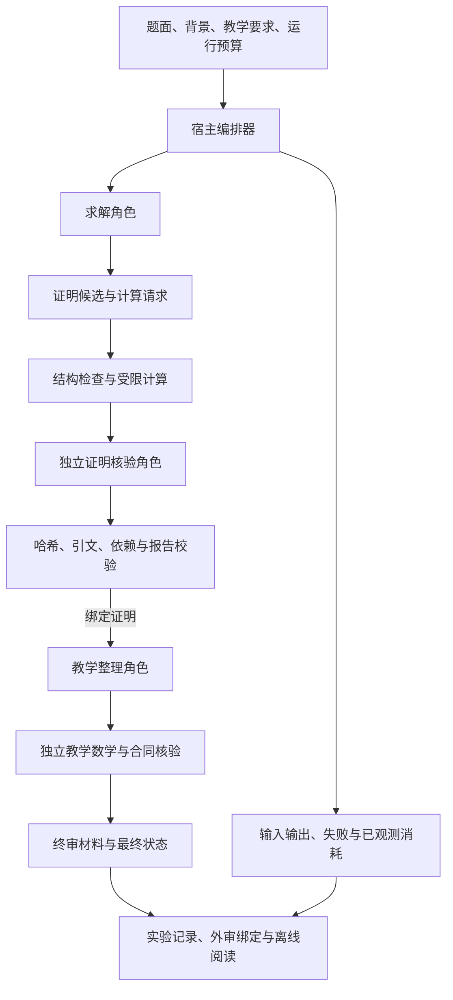

# 架构与工程贡献

本项目把数学推理、教学整理与运行证据管理分开。Rethlas 提供原有证明框架，DeepTutor 提供原生教学智能体能力；本项目新增宿主编排、Windows 适配、合同校验、受限桥接与实验归档。开发采用 AI 辅助，第三方来源见 [说明](../THIRD_PARTY_NOTICES.md)。

## 组件与职责

| 组件 | 职责 | 主要源码 |
|---|---|---|
| 分阶段编排器 | 独立角色会话、有限修订、失败分流、实际材料保存 | [pipeline.py](../scripts/deepseek_rethlas/pipeline.py) · [runtime.py](../scripts/deepseek_rethlas/runtime.py) |
| 证明发布检查 | 严格 JSON、题面/证明/报告哈希绑定与权威回执 | [verification.py](../scripts/rethlas_core/verification.py) · [publication.py](../scripts/rethlas_core/publication.py) |
| 命题合同 | 将证明分块，检查覆盖、引文、状态和前序依赖 | [claims.py](../scripts/rethlas_core/claims.py) |
| 教学合同 | 检查知识清单、前置深度、背景忠实性、整体路线、步骤衔接与主线聚焦 | [teaching_contract.py](../scripts/deepseek_rethlas/teaching_contract.py) |
| 预算与受限计算 | 共享时间/尝试次数、用量准入、精确运算及受限工具请求 | [budget.py](../scripts/rethlas_core/budget.py) · [computation.py](../scripts/rethlas_core/computation.py) |
| 记忆与持久化 | 跨进程文件锁、元数据合并、每次运行的 SQLite 命题版本和状态 | [memory.py](../scripts/rethlas_core/memory.py) |
| 组合桥接 | 异步任务、身份核对、输入冻结、worker 生命周期与取消 | [bridge.py](../scripts/hybrid_tutor/bridge.py) · [deeptutor_runtime.py](../scripts/hybrid_tutor/deeptutor_runtime.py) |
| 记录与评测 | 稳定实验身份、证据快照、最终输出绑定的共同外审与指标展示 | [experiment_records.py](../scripts/experiment_records.py) · [benchmark_evaluation.py](../scripts/benchmark_evaluation.py) |
| 离线阅读 | Markdown 到静态 MathML、原文保留、测试集筛选与 CSV 导出 | [record_reading.py](../scripts/record_reading.py) · [index_dashboard.js](../scripts/index_dashboard.js) |

## 数据流与信任边界

角色输出按数据处理，不能凭模型自称“通过”直接发布。宿主检查相同题面、相同证明、相同核验报告与当前任务的绑定关系。数学语义判断仍依赖模型或人工审阅；结构与哈希检查只验证相应的工程合同。

证明核验通过后，教学稿的改写、例子、推广与练习仍需重新检查。DeepSeek 内部阶段通过后保留 `pending_final_review`，由当前终审会话阅读整套绑定材料，再追加最终状态。离线演示中的合成回执不代表执行了该真实审阅流程。

## 三种运行组织

1. **原版 Codex Rethlas 的 Windows 适配**：保留求解与独立核验角色以及原有 MCP 使用方式，新增本地进程、PowerShell 和归档接入。入口为 [Run-Rethlas.ps1](../scripts/Run-Rethlas.ps1) 与 [Start-Verification.ps1](../scripts/Start-Verification.ps1)。
2. **DeepSeek 分阶段文本适配**：由宿主保存材料并组织独立会话，保留证明合同；未运行原版全部记忆/计算 MCP。升级版 `verified-v2` 加入命题合同、受限宿主计算、预算与状态记忆。入口为 [Run-DeepSeek-Rethlas.ps1](../scripts/Run-DeepSeek-Rethlas.ps1)。
3. **Rethlas＋DeepTutor 组合**：先获得绑定证明，再交给独立教学 worker。组合模式关闭工具、检索、历史记忆等能力，约束教学角色的上下文和调用范围。实现见 [deeptutor_worker.py](../scripts/hybrid_tutor/deeptutor_worker.py)。

DeepTutor 的完整应用安装独立于此仓库。组合模式的收窄不代表原生 DeepTutor 本身没有工具或检索能力；历史实验中原生 B 系统与组合 C 系统采用不同组织方式。

## 关键工程取舍

- **原始材料与派生展示分开。** 原始输入输出和审阅保留，HTML 与索引用于阅读。公式排版出错时保留源文及错误位置，不能通过删改数学符号掩盖问题。
- **失败与数学错误分开。** 服务、流式终态、JSON 合同、预算、计算和数学核验分别记录。部分文本不会因文件已经存在而升级为完整交付。
- **缺测与零消耗分开。** 已观测 Token 小计保留，未知阶段不补零；终审与共同外审费用另计。Token 门槛用于后续调用准入，不是对在途响应的严格硬截断。
- **上下文与预算显式化。** 不跨题检索历史证明来代替当前求解，不自动换提供方或增加重试额度来改变实验结果。
- **公开展示与完整研究档案分开。** 本仓库保留精选源码、合成演示及统计摘要；完整会话、原机器路径与私人评价不随公开版本发布。

## 怎样审阅源码

建议先运行 [离线演示](../examples/offline_demo.py)，再阅读 [verification.py](../scripts/rethlas_core/verification.py) 的绑定合同与对应的 [核验测试](../scripts/tests/test_verification_gate.py)。随后查看 [命题合同测试](../scripts/tests/test_claim_contract.py)、[预算测试](../scripts/tests/test_run_budget.py)、[桥接测试](../scripts/tests/test_hybrid_bridge.py) 和 [实验记录测试](../scripts/tests/test_experiment_records.py)。

这些测试用于检查工程行为。真实生成质量的历史结果与未完成事项见 [RESULTS.md](RESULTS.md)。
